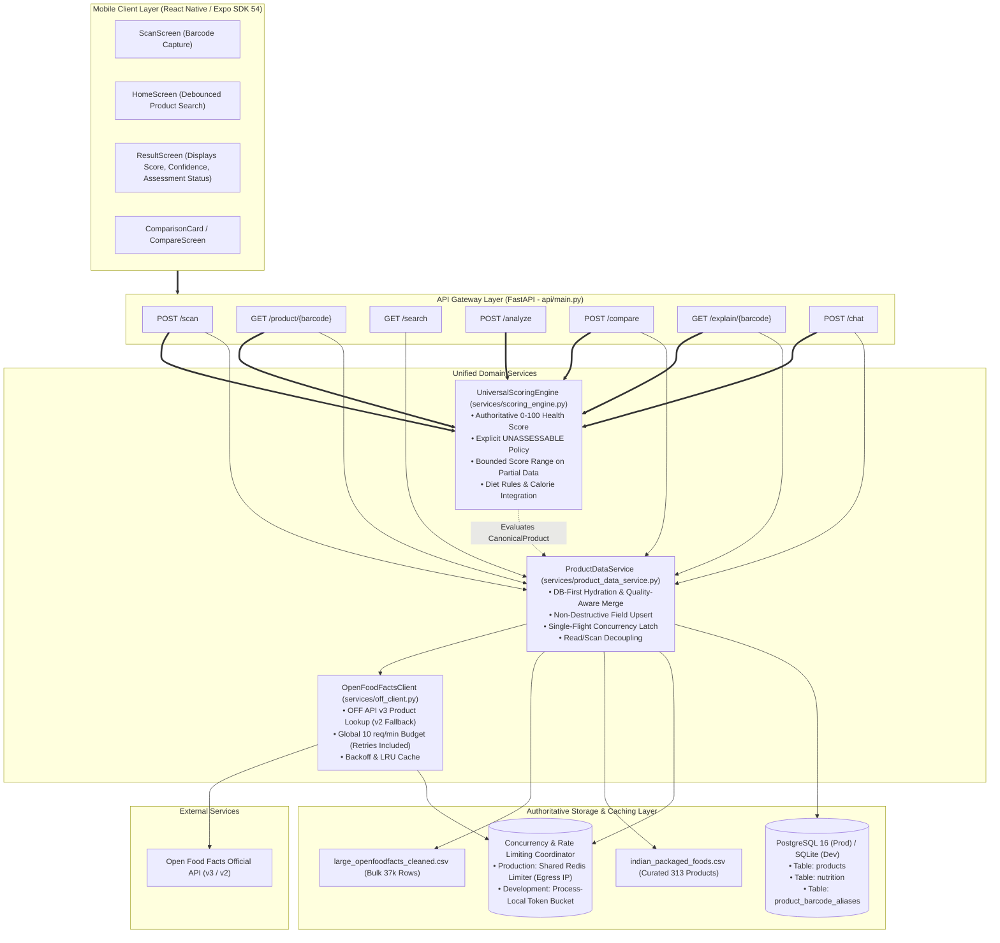
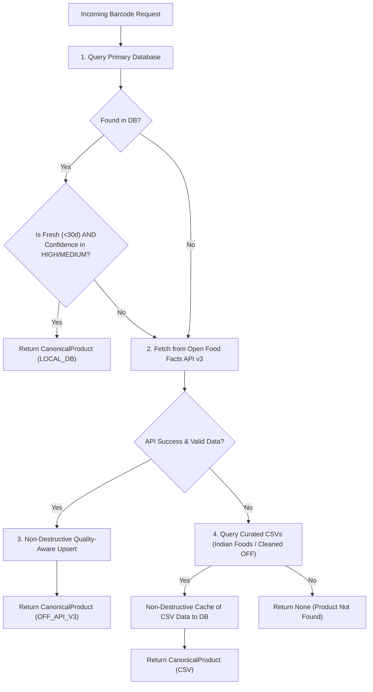
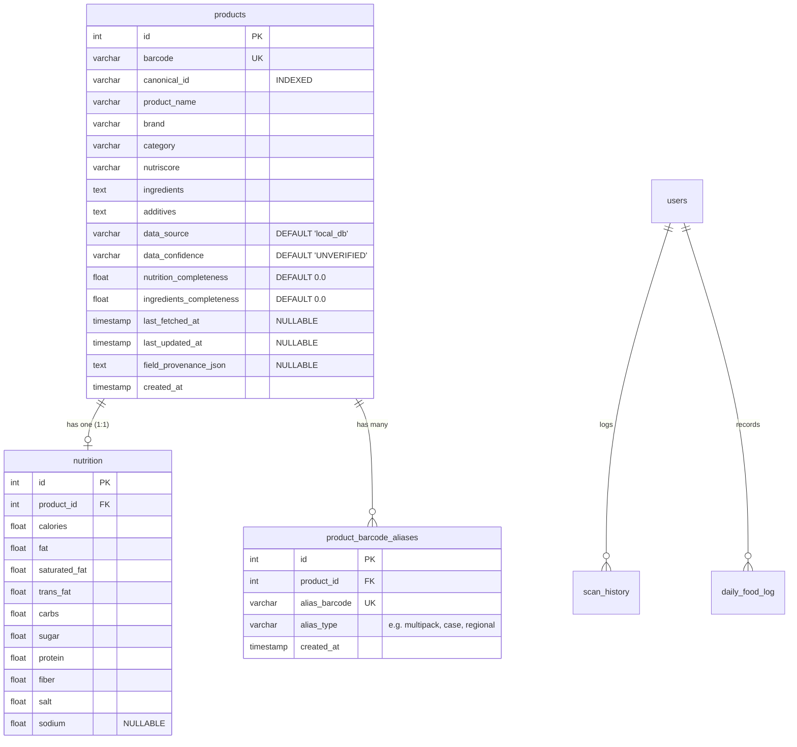

# PRAMAAN — Architecture & Implementation Master Plan
**Open Food Facts API Integration, Authoritative Scoring Engine & Cross-Stack Alignment**

**Document Version:** 2.1 (Reviewed & Finalized Production Roadmap)
**Status:** Approved for Phased Execution
**Target Repository:** `ml-scanner-project`

---

## 1. Executive Summary & Core Invariants

This document establishes the authoritative architecture and implementation blueprint for PRAMAAN (FoodScanner AI). It defines the complete integration of Open Food Facts (OFF) API v3 and resolves all structural conflicts between the remote API, existing local CSV datasets, SQLite/PostgreSQL databases, ML prediction models, and the React Native mobile client.

### Core Invariants & Architectural Non-Negotiables
1. **Preserve All Existing CSV Datasets**: The existing datasets (`foodscanner-ai/datasets/large_openfoodfacts.csv`, `foodscanner-ai/datasets/large_openfoodfacts_cleaned.csv`, and `foodscanner-ai/datasets/indian_foods/indian_packaged_foods.csv`) must remain available for bulk imports, ML training/testing, and offline development workflows. They must not be deleted or modified.
2. **Dual Database Parity**: PostgreSQL 16 is the primary production database (connection pooling, row locks, concurrent transactions). SQLite must continue to work seamlessly for local development and test automation without configuration changes.
3. **Authoritative Backend Scoring**: All health scoring, dietary compliance checks, and NutriScore evaluations must occur in a single authoritative backend scoring engine.
4. **Zero Mobile Scoring**: The mobile application must never independently calculate, invent, or adjust health scores.
5. **Zero Numerical Fabrication**: Missing mandatory nutritional disclosures are never imputed, never treated as zero penalty, and never assigned fabricated scores. If data is unassessable, the score is strictly `None` (`null`).
6. **Egress-Aware Rate Limiting**: All Open Food Facts API calls originate from the backend server's egress IP. Outbound requests must strictly respect the official **15 requests/minute/IP** ceiling. Production must use a shared Redis limiter enforcing a global **10 requests/minute** budget across all workers and replicas, with all retries consuming from the same budget.
7. **Variant Protection**: Distinct products sharing similar or identical names (e.g. "Maggi 2-Minute Masala Noodles" vs "Maggi Special Masala Noodles") must never be merged based on name. Barcodes serve as unique formulation identifiers.
8. **Field-Level Quality-Aware Merge**: Incoming API or CSV data must never overwrite verified, non-null database fields with `None`. Stale data may only be updated when incoming data is demonstrably fresher and higher in completeness.

---

## 2. Target Architecture



---

## 3. Data Contracts & Canonical Schema (`schemas/product.py`)

All product interactions across backend services, database persistence, and external APIs exchange a strictly validated Pydantic model. Neither assessment status nor confidence are given artificial defaults; both are dynamically derived from validated fields.

```python
from __future__ import annotations
from datetime import datetime
from enum import Enum
from typing import Dict, List, Optional
from pydantic import BaseModel, Field

class DataProvenance(str, Enum):
    LOCAL_DB = "local_db"
    ADMIN_VERIFIED = "admin_verified"
    OFF_API_V3 = "openfoodfacts_api_v3"
    OFF_API_V2 = "openfoodfacts_api_v2"
    OFF_CSV = "openfoodfacts_csv"
    INDIAN_CSV = "indian_dataset_csv"
    OCR = "ocr_extracted"
    MANUAL = "manual_entry"

class DataConfidence(str, Enum):
    HIGH = "HIGH"               # Complete mandatory nutrition + ingredients
    MEDIUM = "MEDIUM"           # Complete mandatory nutrition; non-mandatory or ingredients missing
    LOW = "LOW"                 # Mandatory nutrition partially missing
    UNVERIFIED = "UNVERIFIED"   # Identity only; no nutrition disclosed

class AssessmentStatus(str, Enum):
    ASSESSABLE = "ASSESSABLE"
    PARTIALLY_ASSESSABLE = "PARTIALLY_ASSESSABLE"
    UNASSESSABLE = "UNASSESSABLE"

class FieldProvenance(BaseModel):
    source: DataProvenance
    timestamp: Optional[datetime] = None
    confidence: DataConfidence = DataConfidence.HIGH

class Nutrition100g(BaseModel):
    calories: Optional[float] = Field(None, ge=0.0)
    fat: Optional[float] = Field(None, ge=0.0)
    saturated_fat: Optional[float] = Field(None, ge=0.0)
    trans_fat: Optional[float] = Field(None, ge=0.0)
    carbs: Optional[float] = Field(None, ge=0.0)
    sugar: Optional[float] = Field(None, ge=0.0)
    protein: Optional[float] = Field(None, ge=0.0)
    fiber: Optional[float] = Field(None, ge=0.0)
    salt: Optional[float] = Field(None, ge=0.0)
    sodium: Optional[float] = Field(None, ge=0.0)

class ScoreRange(BaseModel):
    min_score: float
    max_score: float

class CanonicalProduct(BaseModel):
    canonical_id: str
    barcode: str
    alternate_barcodes: List[str] = Field(default_factory=list)
    product_name: str
    brand: Optional[str] = None
    category: Optional[str] = None
    variant_name: Optional[str] = None
    serving_size: Optional[str] = None
    nutrition: Nutrition100g = Field(default_factory=Nutrition100g)
    ingredients: Optional[str] = None
    additives: Optional[str] = None
    nutriscore: Optional[str] = None
    is_nutriscore_predicted: bool = False

    # Granular Quality & Completeness (Strictly Derived, No Synthetic Defaults)
    nutrition_completeness: float = Field(0.0, ge=0.0, le=1.0)
    ingredients_completeness: float = Field(0.0, ge=0.0, le=1.0)
    assessment_status: AssessmentStatus = AssessmentStatus.UNVERIFIED
    overall_confidence: DataConfidence = DataConfidence.UNVERIFIED

    # Provenance Tracking
    primary_provenance: DataProvenance = DataProvenance.LOCAL_DB
    field_provenance: Dict[str, FieldProvenance] = Field(default_factory=dict)

    # Optional Timestamps
    last_fetched_at: Optional[datetime] = None
    last_updated_at: Optional[datetime] = None
```

---

## 4. Open Food Facts API Client & Egress-Aware Rate Limiting (`services/off_client.py`)

### A. Egress IP & Shared Production Coordination
- **Egress IP Reality**: All Open Food Facts API requests originate from PRAMAAN's backend servers, not directly from mobile clients. Consequently, Open Food Facts aggregates and rate-limits traffic based on the backend's outbound egress IP address.
- **Hard Limit**: The official documented limit is **15 requests/minute per IP**.
- **Production Redis Coordinator**:
  - In production (Render / Docker cluster with multiple Uvicorn workers and multi-replica auto-scaling), all workers share the same egress IP pool.
  - A shared Redis limiter (sliding window counter `ratelimit:off_egress_ip`) is **mandatory in production** to coordinate outbound requests across all workers and dynamically scaled replicas.
  - Production shared global budget: **10 requests/minute** on product lookups (giving a 33% safety buffer) and **4 requests/minute** on search.
- **Retries Included in Budget**:
  - Retries are **never exempt** from the rate limiter. Every outbound HTTP attempt (initial request, retry 1, retry 2) must acquire a token from the Redis limiter before transmission.
  - If a token is unavailable when a retry is scheduled, the retry is aborted immediately and the system falls back to local data rather than violating the egress IP limit.
- **Process-Local Limitation & Fallback (When Redis is Unavailable)**:
  - When Redis is absent (e.g. single-process local development), the system falls back to an in-memory token bucket.
  - **Explicit Operational Reality**: A process-local limiter **cannot guarantee a global ceiling** when workers or replicas scale dynamically. Therefore:
    - In development / standalone mode, each worker process is statically capped at a conservative **5 requests/minute**.
    - For multi-worker or multi-replica production environments, Redis is documented as an indispensable operational prerequisite.

### B. Verified User-Agent Identification
In compliance with Open Food Facts policy, the User-Agent uses the verified repository identifier without invented email or URLs:
```python
USER_AGENT = os.environ.get("OFF_USER_AGENT", "Pramaan-FoodScanner/1.0")
```

### C. Timeouts, Backoff & Error Protocols
- Connect timeout: `2.0s`. Read timeout: `4.0s`. Total timeout budget: `6.0s`.
- On HTTP `404`: Fast-fail immediately (0 retries, no v2 fallback).
- On HTTP `429`: Parse `Retry-After` header (minimum 60s cooldown); all outbound calls instantly short-circuit to local DB/CSV during the cooldown.
- On HTTP `5xx` / Timeout: Retry up to 2 times with jittered backoff ($0.5s \times 2^{\text{attempt}} + \text{jitter}$), provided rate limit tokens can be acquired.
- Every retry and fallback attempt consumes a rate limit token from the endpoint budget.

### D. In-Memory LRU Cache & Offline Fallback Contract
- **Bounded LRU Cache**: Successful lookups are cached in-memory (`max_size=1000`, `default_ttl=3600s`).
- **Defensive Copying**: Immutability is enforced via deep defensive copying on storage and retrieval, preventing cache corruption by callers.
- **Strict Error Exclusion**: Failed responses (404, 5xx, timeouts, 429, malformed payloads) are never cached.
- **Cache-Key Isolation**: Barcode lookups (`product:{barcode}`) and searches (`search:{query}:{limit}`) maintain distinct namespaces.
- **Offline Fallback Contract**: The client distinguishes `SUCCESS`, `NOT_FOUND`, `INVALID_BARCODE`, `RATE_LIMITED`, `NETWORK_UNAVAILABLE`, `SERVER_ERROR`, and `MALFORMED_RESPONSE`. When OpenFoodFacts is unavailable or rate-limited, controlled fallback results enable existing application workflows to seamlessly query local DB and curated CSV datasets.

### E. Environment Configuration Variables
- `OFF_USER_AGENT`: Configurable HTTP User-Agent header (defaults to `Pramaan-FoodScanner/1.0`).
- `WEB_CONCURRENCY`: Process worker count used for process-local rate limit allocation (defaults to `2`).
- `RENDER_INSTANCE_COUNT`: Replica instance count used for process-local allocation (defaults to `1`).
- `REDIS_URL`: Connection string for shared multi-worker Redis rate limiter (optional; falls back to process-local allocation when absent).

---

## 5. DB-First Product Data Service & Quality-Aware Merge (`services/product_data_service.py`)

### A. Retrieval Hierarchy


### B. Deterministic Quality-Aware Merge Rules
1. **Non-Null Invariant**: Existing non-null database fields are never overwritten with `None` or empty strings.
2. **Admin Verification Lock**: Fields with `provenance == ADMIN_VERIFIED` are immutable to automated API updates.
3. **Explicit Zero Semantics**: Explicit 0.0 is a valid numeric disclosure and is strictly preserved (never converted to None or fabricated).
4. **Confidence & Provenance Precedence**: Higher confidence disclosures (`HIGH` > `MEDIUM` > `LOW` > `UNVERIFIED`) and higher provenance sources (`ADMIN_VERIFIED` > `MANUAL` > `OCR` > `OFF_API_V3` > `OFF_API_V2` > `INDIAN_CSV` > `OFF_CSV` > `LOCAL_DB`) take precedence.
5. **Freshness & Quality Precedence**: An existing field is updated if and only if:
   - The incoming field is non-null and valid, **AND**
   - The incoming record's timestamp is fresher, **AND**
   - The incoming record's nutrition completeness is $\ge$ existing completeness.
6. **Variant Protection Rule**: Products with similar or identical names but different barcodes are strictly maintained as distinct database rows. Barcodes are unique formulation identifiers.
7. **Decoupled Read Lookups**: Retrieval operations for `/product/{barcode}`, `/compare`, `/explain`, `/chat`, and `/alternatives` are idempotent and **never** insert into `scan_history`. Only explicit `/scan` calls log scans.

### C. Single-Flight Concurrency & Offline Fallback Contract
- **Single-Flight Latch**: Concurrent requests for the same uncached barcode share a single outbound network flight, eliminating thundering-herd API consumption.
- **Configurable TTL**: `OFF_CACHE_TTL_DAYS` (default: `30` days). Missing timestamps are never assumed fresh.
- **Graceful Fault Tolerance**: Stale database records are returned when OpenFoodFacts returns 429, 5xx, timeouts, or network errors. Database write errors gracefully return the in-memory `CanonicalProduct` without failing user operations.
- **Curated CSV Fallback**: Missing products trigger local lookups against `large_openfoodfacts_cleaned.csv` and `indian_packaged_foods.csv`, caching successful results non-destructively to the database.

---

## 6. Universal Authoritative Scoring Engine (`services/scoring_engine.py`)

### A. Strict Nutrition Assessability & Decision Policy

```
+----------------------------------------------------------------------------------------------------+
|                               NUTRITION ASSESSABILITY & DECISION POLICY                            |
+----------------------------------------------------------------------------------------------------+
| 1. COMPLETE (All 4 mandatory nutrients present: calories, sugar, fat, salt/sodium)                 |
|    - Assessment Status: `ASSESSABLE`                                                               |
|    - Health Score: Exact 0-100 calculated score.                                                   |
|    - Score Range: `null`                                                                           |
|    - Final Decision: `SAFE` (>=70), `MODERATE` (45-69), `AVOID` (<45).                             |
|    - Overall Confidence: `HIGH` (if ingredients present) or `MEDIUM`.                             |
|                                                                                                    |
| 2. PARTIAL (1 to 3 mandatory nutrients missing)                                                    |
|    - Assessment Status: `PARTIALLY_ASSESSABLE`                                                     |
|    - Health Score: strictly `None` (null). Zero numerical scores are fabricated.                   |
|    - Score Range: `{ "min_score": X, "max_score": Y }` where:                                      |
|        * max_score: calculated assuming undeclared nutrients have 0 penalty.                      |
|        * min_score: calculated assuming undeclared nutrients have maximum penalties                |
|          (sugar=-35, salt=-30, fat=-30, calories=-15).                                             |
|    - Final Decision:                                                                               |
|        * If max_score < 45 OR ingredient/diet flags mandate AVOID -> `AVOID`.                        |
|        * Otherwise -> `INCOMPLETE_DATA` (cannot determine if SAFE or MODERATE).                    |
|    - Overall Confidence: `LOW`                                                                     |
|    - Reasons: Enumerates detected penalties and lists missing mandatory disclosures.               |
|                                                                                                    |
| 3. ZERO NUTRITION (All 4 mandatory nutrients missing)                                              |
|    - Assessment Status: `UNASSESSABLE`                                                             |
|    - Health Score: strictly `None` (null).                                                         |
|    - Score Range: `null`                                                                           |
|    - Final Decision: `INSUFFICIENT_DATA`                                                           |
|    - Overall Confidence: `UNVERIFIED`                                                              |
|    - Reasons: ["Product packaging does not disclose mandatory nutritional values per 100g."]       |
+----------------------------------------------------------------------------------------------------+
```

### B. Diet-Specific Mandatory Requirements
- **Diabetic Diet**: `sugar` **AND** `carbs` are strictly mandatory. Missing either yields `UNASSESSABLE_DIABETIC`.
- **Low-Sodium Diet**: `salt` **OR** `sodium` is strictly mandatory. Missing both yields `UNASSESSABLE_SODIUM`.
- **Vegan / Vegetarian Diet**: `ingredients` text is strictly mandatory. Missing yields `UNASSESSABLE_INGREDIENTS`.
- **Calorie Budget / Goal Tracking**: `calories` is strictly mandatory.

### C. Salt & Sodium Conversion Standards
$$\text{Salt (g)} = \text{Sodium (g)} \times 2.5$$
- If declared `sodium` is in milligrams: $\text{sodium (g)} = \text{sodium (mg)} / 1000.0$.
- If both are declared: verify $|\text{salt} - \text{sodium} \times 2.5| \le 0.1$. If inconsistent, prefer package `salt_100g`.

### D. Preserved Scoring Weights & Thresholds
All existing verified scoring weights remain 100% unchanged:
- Baseline score: `100`.
- Sugar penalties: `<=5g (0)`, `<=10g (-10)`, `<=20g (-20)`, `>20g (-35)`.
- Salt penalties: `<=0.3g (0)`, `<=1.0g (-10)`, `<=1.5g (-20)`, `>1.5g (-30)`.
- Fat penalties: `<=3g (0)`, `<=17.5g (-10)`, `<=25g (-20)`, `>25g (-30)`.
- Saturated Fat penalty: `>5g (-10)`.
- Calories penalties: `<200 (0)`, `<=400 (-5)`, `>400 (-15)`.
- Protein bonuses: `>5g (+8)`, `>10g (+15)`.
- Fiber bonuses: `>3g (+8)`, `>6g (+15)`.
- NutriScore adjustments: `A (+15)`, `B (+8)`, `C (0)`, `D (-10)`, `E (-20)`.
- Decision thresholds: `>=70: SAFE`, `45-69: MODERATE`, `<45: AVOID`.

---

## 7. Database Schema Migration Plan (Alembic 004)

Schema migrations occur in **Phase 2**, before any services depend on the new columns:



### A. Final Database to Canonical Mapping
The canonical contract `CanonicalProduct` ([`foodscanner-ai/schemas/product.py`](file:///Users/sandeshshinde/ml-scanner-project/foodscanner-ai/schemas/product.py)) is decoupled from persistence via [`database/canonical_adapter.py`](file:///Users/sandeshshinde/ml-scanner-project/foodscanner-ai/database/canonical_adapter.py):

| Canonical Product Field | Database Table & Column | Mapping Rule / Behavior |
| :--- | :--- | :--- |
| `canonical_id` | `products.canonical_id` | Explicit string; falls back to `products.barcode` if unassigned |
| `barcode` | `products.barcode` | Primary package barcode (unique) |
| `alternate_barcodes` | `product_barcode_aliases.alias_barcode` | One-to-many relationship loaded as list of strings |
| `product_name` | `products.product_name` | Direct string |
| `brand` | `products.brand` | Direct string (nullable) |
| `category` | `products.category` | Direct string (nullable) |
| `nutriscore` | `products.nutriscore` | Grade string a-e (nullable) |
| `ingredients` | `products.ingredients` | Plain text ingredients list (nullable) |
| `additives` | `products.additives` | Extracted additives or tags (nullable) |
| `primary_provenance` | `products.data_source` | Maps string to `DataProvenance` enum (fallback `LOCAL_DB`) |
| `field_provenance` | `products.field_provenance_json` | JSON string parsed to `Dict[str, FieldProvenance]` |
| `nutrition.calories` | `nutrition.calories` | Float kcal per 100g (nullable, never 0 for missing) |
| `nutrition.fat` | `nutrition.fat` | Float grams per 100g (nullable) |
| `nutrition.saturated_fat`| `nutrition.saturated_fat` | Float grams per 100g (nullable) |
| `nutrition.trans_fat` | `nutrition.trans_fat` | Float grams per 100g (nullable) |
| `nutrition.carbs` | `nutrition.carbs` | Float grams per 100g (nullable) |
| `nutrition.sugar` | `nutrition.sugar` | Float grams per 100g (nullable) |
| `nutrition.protein` | `nutrition.protein` | Float grams per 100g (nullable) |
| `nutrition.fiber` | `nutrition.fiber` | Float grams per 100g (nullable) |
| `nutrition.salt` | `nutrition.salt` | Float grams per 100g (nullable) |
| `nutrition.sodium` | `nutrition.sodium` | Float grams per 100g (nullable, converts to salt via $\times 2.5$) |
| `assessment_status` | *(Computed Property)* | Dynamically derived upon access via Phase 1 rules; not stored redundantly |
| `overall_confidence` | `products.data_confidence` | Dynamically derived upon access; cached in column for SQL queries |
| `nutrition_completeness`| `products.nutrition_completeness` | Dynamically derived upon access; cached in column for SQL queries |
| `ingredients_completeness`| `products.ingredients_completeness` | Dynamically derived upon access; cached in column for SQL queries |

### B. Migration Design (Alembic Revision 004)
- **Revision Identifier**: `004_add_provenance_and_aliases`
- **Down Revision**: `003_add_saturated_and_trans_fat`
- **Additive Columns**:
  - `products`: `category`, `canonical_id`, `data_source`, `data_confidence`, `nutrition_completeness`, `ingredients_completeness`, `last_fetched_at`, `last_updated_at`, `field_provenance_json`.
  - `nutrition`: `sodium`.
- **Relational Table**: `product_barcode_aliases` with foreign key `ON DELETE CASCADE` referencing `products.id`.
- **Indexes**: `ix_products_canonical_id` on `products.canonical_id`, `ix_product_barcode_aliases_product_id` on `product_id`, and unique index `ix_product_barcode_aliases_barcode` on `alias_barcode`.

### C. Idempotent Data Backfill
The upgrade migration automatically and idempotently updates historical pre-existing records:
1. `canonical_id`: Sets `canonical_id = barcode` for all rows where `canonical_id IS NULL`.
2. `data_source`: Sets `data_source = 'local_db'` for historical records without explicit provenance.
3. `data_confidence`: Sets `data_confidence = 'UNVERIFIED'` to prevent unverified legacy data from falsely claiming HIGH confidence.
4. `nutrition_completeness` & `ingredients_completeness`: Backfills defaults (`0.0`) for any NULL rows.
5. Preserves all existing IDs, foreign keys, relationships, and NULL disclosures.

### D. PostgreSQL & SQLite Dialect Compatibility
- **Alembic `batch_alter_table`**: Used for all column alterations and table re-definitions, ensuring seamless execution across SQLite (table-rebuilding strategy) and PostgreSQL (`ALTER TABLE ADD/DROP COLUMN`).
- **PostgreSQL Connection Pooling**: Production connection pool configuration with `pool_pre_ping=True`, customizable pool sizes (`DB_POOL_SIZE`, `DB_MAX_OVERFLOW`), and recycling.
- **SQLite Concurrency**: Local SQLite engines maintain `check_same_thread=False` and runtime PRAGMA foreign keys for integration tests.

### E. Safe Migration & Rollback Commands
- **Run Migrations Safely**:
  ```bash
  cd foodscanner-ai
  alembic upgrade head
  ```
- **Safe Downgrade (Rollback)**:
  ```bash
  cd foodscanner-ai
  alembic downgrade 003_add_saturated_and_trans_fat
  ```
  *(Downgrade drops the alias table and added columns without touching core product or nutrition rows).*

### F. Deferred Scope (Handled in Subsequent Phases)
- **Phase 3**: Open Food Facts API v3 client with rate-limiting and cache integration.
- **Phase 4**: `ProductDataService` DB-first lookup and quality-aware merge rules.
- **Phase 5**: Authoritative scoring engine integration with explicit `UNASSESSABLE` policy.

---

## 8. Corrected Phase-by-Phase Implementation Plan

```
Phase 1: Canonical Data Contracts & Universal Schemas
   │
   ▼
Phase 2: Database Schema Migration & Storage Parity (Alembic 004)
   │
   ▼
Phase 3: Resilient Open Food Facts API Client (v3 Product, v2 Fallback)
   │
   ▼
Phase 4: Product Data Service & Multi-Worker Safe DB Cache
   │
   ▼
Phase 5: Universal Authoritative Scoring Engine (Explicit UNASSESSABLE Policy)
   │
   ▼
Phase 6: Backend Endpoint Migration (/scan, /product/, /search, /compare, etc.)
   │
   ▼
Phase 7: Mobile Application Alignment (Confidence Badges & Routing)
   │
   ▼
Phase 8: Existing Database & Dataset Safe Enrichment Script
   │
   ▼
Phase 9: Comprehensive Regression Suite & Benchmark Consistency
   │
   ▼
Phase 10: Production Deployment, Monitoring & ODbL Compliance
```

---

## 9. Exact File Impact Inventory

| Action | File Path | Phase | Purpose |
| :--- | :--- | :--- | :--- |
| **Create** | `foodscanner-ai/schemas/__init__.py` | Phase 1 | Package initialization |
| **Create** | `foodscanner-ai/schemas/product.py` | Phase 1 | Pydantic canonical schemas with field-level provenance |
| **Create** | `foodscanner-ai/migrations/versions/004_add_provenance_and_aliases.py` | Phase 2 | Alembic migration for provenance columns and aliases table |
| **Create** | `foodscanner-ai/services/off_client.py` | Phase 3 | Isolated OFF client with 10 req/min budget & caching |
| **Create** | `foodscanner-ai/services/product_data_service.py` | Phase 4 | DB-first lookup, quality-aware merge, variant isolation, concurrency |
| **Create** | `foodscanner-ai/services/scoring_engine.py` | Phase 5 | Universal scoring engine with explicit UNASSESSABLE policy |
| **Create** | `foodscanner-ai/scripts/enrich_incomplete_products.py` | Phase 8 | Safe non-destructive background enrichment script |
| **Create** | `foodscanner-ai/tests/test_canonical_schemas.py` | Phase 1 | Unit tests for canonical schemas |
| **Create** | `foodscanner-ai/tests/test_off_client.py` | Phase 3 | Unit tests for OFF client and rate limiter |
| **Create** | `foodscanner-ai/tests/test_product_data_service.py` | Phase 4 | Unit tests for product data service and merge rules |
| **Create** | `foodscanner-ai/tests/test_scoring_engine.py` | Phase 5 | Unit tests for scoring engine and assessability policies |
| **Create** | `foodscanner-ai/tests/test_cross_endpoint_scoring_consistency.py` | Phase 9 | Cross-endpoint scoring consistency validation suite |
| **Create** | `foodscanner-ai/tests/test_benchmark_products_regression.py` | Phase 9 | Benchmark regression suite (Maggi, Parle-G, Amul, Kurkure, Coke) |
| **Modify** | `foodscanner-ai/database/models.py` | Phase 2 | Add provenance columns and `ProductBarcodeAlias` ORM model |
| **Modify** | `foodscanner-ai/services/openfoodfacts_service.py` | Phase 3 | Wrap `OpenFoodFactsClient` for legacy compatibility |
| **Modify** | `foodscanner-ai/services/db_service.py` | Phase 4 | Implement quality-aware non-destructive upserts |
| **Modify** | `foodscanner-ai/services/barcode_lookup.py` | Phase 4 | Refactor to delegate to `ProductDataService` |
| **Modify** | `foodscanner-ai/services/food_health_score.py` | Phase 5 | Redirect to `UniversalScoringEngine` |
| **Modify** | `foodscanner-ai/services/final_decision_engine.py` | Phase 5 | Integrate with `UniversalScoringEngine` |
| **Modify** | `foodscanner-ai/services/score_explainer.py` | Phase 5 | Integrate with `UniversalScoringEngine` |
| **Modify** | `foodscanner-ai/api/main.py` | Phase 6 | Route all endpoints through `ProductDataService` & scoring engine |
| **Modify** | `foodscanner-ai/services/recommendation_engine.py` | Phase 6 | Use shared product service and scoring engine |
| **Modify** | `foodscanner-ai/services/ai_nutrition_assistant.py` | Phase 6 | Ground AI responses with authoritative scores |
| **Modify** | `foodscanner-mobile/src/screens/ResultScreen.js` | Phase 7 | Render confidence chips and assessment status |
| **Modify** | `foodscanner-mobile/src/screens/HomeScreen.js` | Phase 7 | Maintain clean search routing and add ODbL notice |
| **Modify** | `foodscanner-mobile/src/screens/ProfileScreen.js` | Phase 7 | Add Open Food Facts ODbL attribution notice |
| **Modify** | `foodscanner-ai/services/metrics.py` | Phase 10 | Add Prometheus metrics for OFF API, cache hits, assessment |
| **Modify** | `render.yaml` | Phase 10 | Add OFF rate limit and Redis connection settings |
| **Modify** | `.env.example` | Phase 10 | Document OFF rate limiting and concurrency variables |
| **Preserve**| `foodscanner-ai/datasets/large_openfoodfacts.csv` | All | Strictly preserved (Important Decision #1) |
| **Preserve**| `foodscanner-ai/datasets/large_openfoodfacts_cleaned.csv`| All | Strictly preserved (Important Decision #1) |
| **Preserve**| `foodscanner-ai/datasets/indian_foods/indian_packaged_foods.csv`| All | Strictly preserved (Important Decision #2) |

---

## 10. Comprehensive Regression Matrix (5 Benchmark Products)

The 5 benchmark products must produce identical scores and decisions across every endpoint:

| Benchmark Product | Primary Barcode | Nutritional Profile | Expected Decision | Core Verification Invariant |
| :--- | :--- | :--- | :--- | :--- |
| **Maggi 2-Minute Noodles** | `8901058851304` | High Sodium & Carbs | `MODERATE` / `AVOID` | High sodium penalty applied identically across `/scan`, `/compare`, `/product/` |
| **Parle-G Biscuits** | `8901719101038` | High Sugar & Refined Wheat | `MODERATE` / `AVOID` | Sugar penalty and diabetic avoid trigger identical across all endpoints |
| **Amul Butter** | `8901262010320` | High Fat & Saturated Fat | `MODERATE` / `AVOID` | Saturated fat penalty applied identically |
| **Kurkure Masala Munch** | `8901491100519` | High Fat & Salt, INS 621 | `AVOID` | Sodium/fat penalties + INS 621 additive risk matched identically |
| **Coca-Cola** | `5449000000996` | High Sugar (10.6g), 0 Fat | `AVOID` | Pure sugar penalty (-35 pts) produces score < 45 across all endpoints |

---

## 11. Open Food Facts License & Attribution (ODbL 1.0)

### A. License Compliance
- Open Food Facts database data is licensed under the **Open Database License (ODbL) v1.0**.
- Individual photos and textual descriptions are licensed under **Creative Commons Attribution-ShareAlike 3.0 (CC BY-SA 3.0)**.

### B. Mandatory Attribution
The following attribution notice is displayed in the mobile app (`ProfileScreen.js`, `HomeScreen.js`) and API documentation (`/docs`, `/health`):
> *"Product data sourced from Open Food Facts (https://openfoodfacts.org), made available under the Open Database License (ODbL) v1.0."*
Link: `https://opendatacommons.org/licenses/odbl/1-0/`.

---

## 12. Recommended Commit Boundaries

| Commit # | Scope | Commit Message Title | Files Included |
| :--- | :--- | :--- | :--- |
| **Commit 1** | Schema | `feat(domain): define CanonicalProduct schemas with field provenance` | `schemas/__init__.py`, `schemas/product.py`, `tests/test_canonical_schemas.py` |
| **Commit 2** | Migration | `feat(db): add Alembic migration 004 for provenance and barcode aliases`| `migrations/.../004_*.py`, `database/models.py`, `tests/test_alembic_migrations.py` |
| **Commit 3** | Integration | `feat(integrations): implement resilient OpenFoodFacts API v3 client` | `services/off_client.py`, `services/openfoodfacts_service.py`, `tests/test_off_client.py` |
| **Commit 4** | Data Service | `feat(data): implement ProductDataService with quality-aware merge` | `services/product_data_service.py`, `services/db_service.py`, `services/barcode_lookup.py` |
| **Commit 5** | Scoring | `feat(scoring): implement UniversalScoringEngine with UNASSESSABLE policy`| `services/scoring_engine.py`, `services/food_health_score.py`, `final_decision_engine.py` |
| **Commit 6** | API | `refactor(api): route all product endpoints through universal engine` | `api/main.py`, `services/recommendation_engine.py`, `services/ai_nutrition_assistant.py` |
| **Commit 7** | Mobile | `feat(mobile): display data confidence and assessment status chips` | `foodscanner-mobile/src/screens/{ResultScreen,HomeScreen,ProfileScreen}.js` |
| **Commit 8** | Enrichment | `chore(data): add safe non-destructive database enrichment script` | `scripts/enrich_incomplete_products.py`, `tests/test_enrichment_script.py` |
| **Commit 9** | Regression | `test(regression): add cross-endpoint consistency and benchmark suite` | `tests/test_cross_endpoint_scoring_consistency.py`, `test_benchmark_products_regression.py` |
| **Commit 10**| Deploy | `chore(deploy): configure Prometheus metrics, ODbL notices and configs` | `services/metrics.py`, `render.yaml`, `.env.example` |
